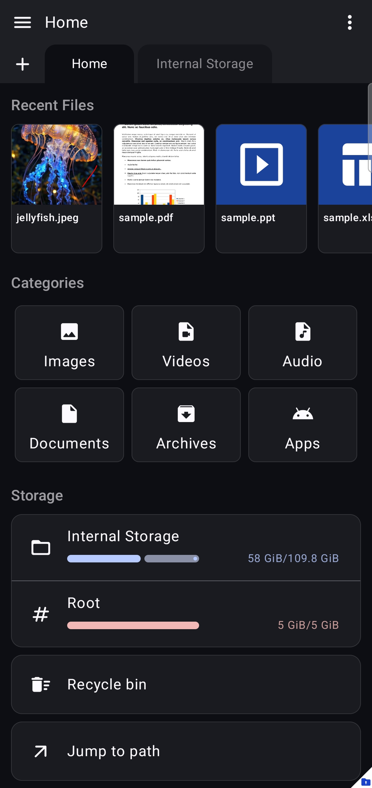
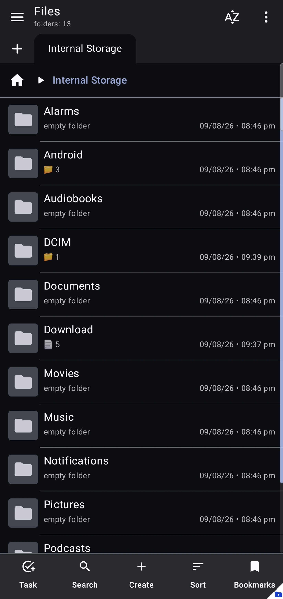
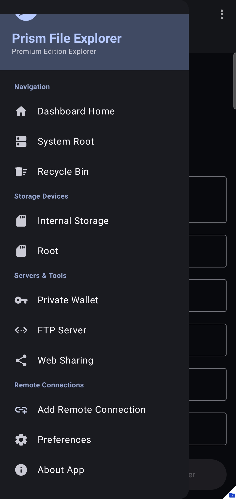
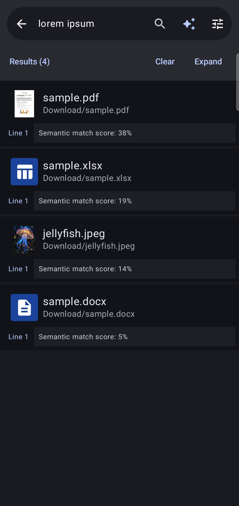
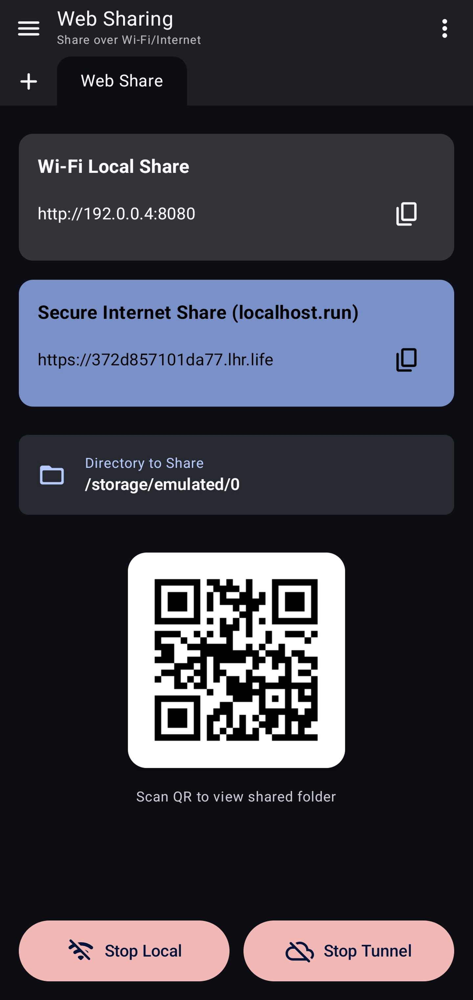
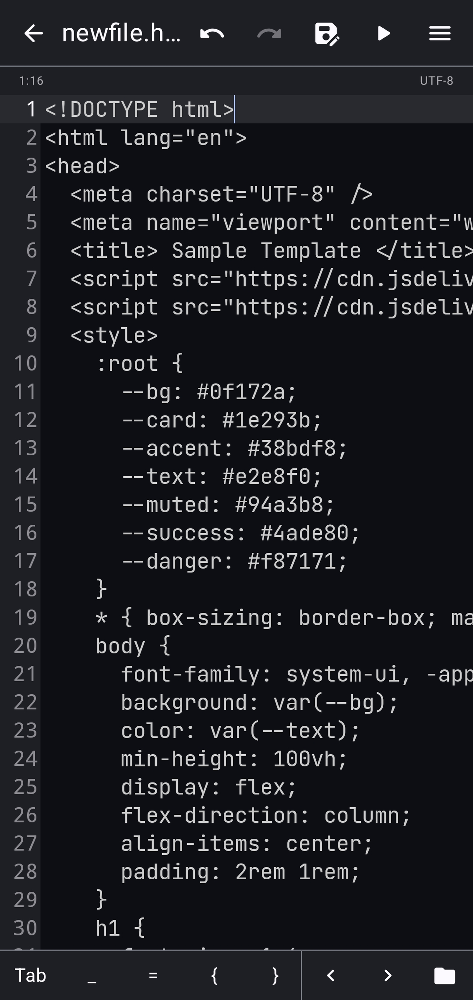
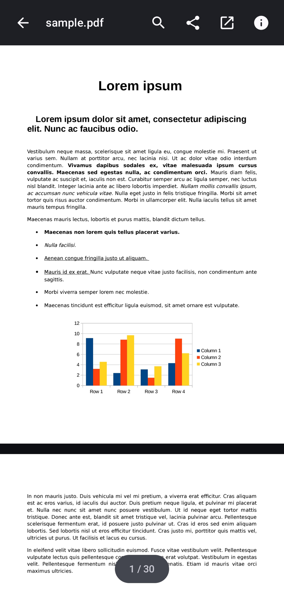
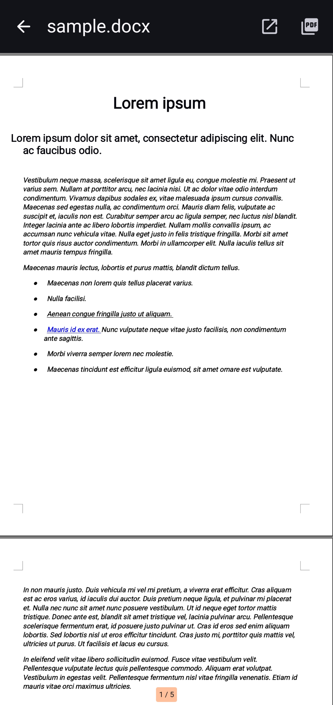
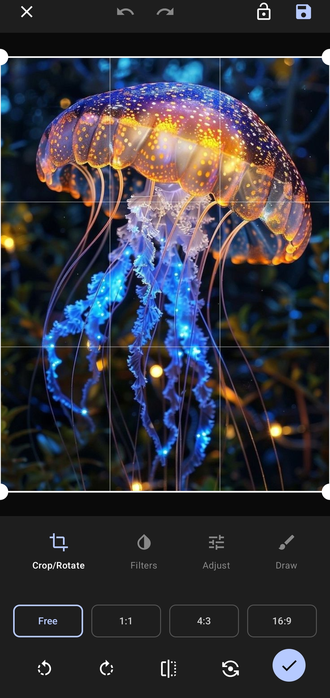
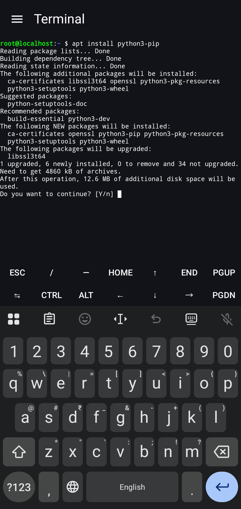

<div align="center">


# Prism File Explorer +

### The file manager that does the work of ten apps.

Browse, read, edit, share, lock and automate your files — all in one free, open-source Android app.

[](https://www.android.com/)
[](https://developer.android.com/compose)
[](LICENSE)
[](https://github.com/techflyers/Prism-File-Explorer/releases)
[](https://github.com/techflyers/Prism-File-Explorer/stargazers)
[](https://github.com/techflyers/Prism-File-Explorer/network/members)
[](https://github.com/techflyers/Prism-File-Explorer/commits/master)
[](https://github.com/techflyers/Prism-File-Explorer/actions/workflows/android.yml)

[**Download**](#-download) · [**Screenshots**](#-screenshots) · [**Features**](#-everything-it-can-do) · [**FAQ**](#-faq) · [**Build it**](#-build-it-yourself) · [**Contribute**](#-contribute)

</div>

---

## ✨ Why Prism +?

Most file managers copy, paste and delete. **Prism + does that too — then keeps going.**

| | |
|---|---|
| 📖 **Opens almost anything** | PDF, Word, Excel, PowerPoint, e-books, comics, Markdown, LaTeX, code, video, audio. No extra apps needed. |
| 🛠️ **Built-in tools** | Edit PDFs, edit images, merge videos, find duplicates, run a Linux terminal. |
| 🔒 **Keeps secrets safe** | A PIN-locked Private Wallet and folder locks. |
| 🌐 **Shares and connects** | Run an FTP server, share to any browser, or open FTP, SFTP, WebDAV and SMB servers. |
| 🧠 **Searches smartly** | Find files by *meaning*, or by the text inside photos and scanned PDFs. All on your phone. |
| 🎨 **Looks great** | Material 3 design, light and dark themes, tabs, and a fast Compose interface. |

> **Prism +** is an extended version of [Prism File Explorer](https://github.com/Raival-e/Prism-File-Explorer) by Raival-e. It adds **74 new features** and **12 big upgrades**. [See the full list ↓](#-whats-new-compared-to-the-original)

---

## 📥 Download

[](https://github.com/techflyers/Prism-File-Explorer/releases)
[](https://nightly.link/techflyers/Prism-File-Explorer/workflows/android/master/prism-universal-pre-release.zip)

**Which one should I pick?**

| | 🟢 Stable release | 🟠 Pre-release (newest build) |
|---|---|---|
| **Where from** | [GitHub Releases](https://github.com/techflyers/Prism-File-Explorer/releases) | Built automatically from the latest `master` code |
| **Best for** | Everyday use | Trying new features early |
| **Bugs** | Fewer | More likely |
| **Install** | Replaces or updates your current app | Installs **next to** the stable app  |
| **File** | APK for your CPU, or a universal APK | A ZIP that holds one universal APK |

**Quick install**

1. Download the APK from **Releases**. Pick `arm64-v8a` for most modern phones, or the *universal* APK if you are not sure.
2. *Want the newest build instead?* Tap **Pre-release APK**, unzip the file, and open the APK inside.
3. Open the APK and allow *"Install from this source"* if Android asks.
4. Start the app and allow file access when asked. The first-run screen explains why.

**Requirements:** Android 8.0 (API 26) or newer.

<details>
<summary><b>🔗 Pre-release links and how they work</b></summary>
<br/>

| Link | What it does |
|---|---|
| [Direct download (ZIP)](https://nightly.link/techflyers/Prism-File-Explorer/workflows/android/master/prism-universal-pre-release.zip) | Always gives you the newest successful build. |
| [Download page](https://nightly.link/techflyers/Prism-File-Explorer/workflows/android/master/prism-universal-pre-release) | Shows the build details before you download. |
| [Build history](https://github.com/techflyers/Prism-File-Explorer/actions/workflows/android.yml) | See every build and whether it passed. |

- A new build starts when app code is pushed to `master`. The first link always points to the latest one that **passed**.
- GitHub deletes old build files after a set time (90 days by default). The link keeps working as long as a recent build exists.
- Pre-release builds come from the [techflyers](https://github.com/techflyers/Prism-File-Explorer) repository. Your stable app and its data are not touched.

</details>

---

## 📱 Screenshots

<div align="center">
<table>
  <tr>
    <td align="center"><br/><sub><b>Home</b><br/>Recent files &amp; categories</sub></td>
    <td align="center"><br/><sub><b>Files</b><br/>Tabs &amp; breadcrumbs</sub></td>
    <td align="center"><br/><sub><b>Apps</b><br/>See &amp; extract apps</sub></td>
    <td align="center"><br/><sub><b>Drawer</b><br/>Wallet, FTP, Web share</sub></td>
    <td align="center"><br/><sub><b>Smart search</b><br/>Search by meaning</sub></td>
    <td align="center"><br/><sub><b>Web share</b><br/>QR code &amp; link</sub></td>
  </tr>
  <tr>
    <td align="center"><br/><sub><b>Code editor</b><br/>49+ languages</sub></td>
    <td align="center"><br/><sub><b>PDF viewer</b><br/>Page bubble</sub></td>
    <td align="center"><br/><sub><b>PDF reading</b><br/>Select, search, zoom</sub></td>
    <td align="center"><br/><sub><b>Word viewer</b><br/>Opens .docx</sub></td>
    <td align="center"><br/><sub><b>Image editor</b><br/>Crop, filters, draw</sub></td>
    <td align="center"><br/><sub><b>Terminal</b><br/>Ubuntu inside the app</sub></td>
  </tr>
</table>
</div>

---

## 🚀 Everything it can do

Tap a section to open it.

<details open>
<summary><b>📖 Read almost any file (10 features)</b></summary>
<br/>

| Feature | What you get |
|---|---|
| **Office files** | Word, PowerPoint and OpenDocument files. Use the optional LibreOffice engine for best looks, or the built-in viewer. |
| **Spreadsheets** | XLS, XLSX, ODS, CSV and TSV in a scrollable grid with sheet tabs. |
| **E-books** | EPUB, MOBI, AZW, AZW3, PRC, FB2, RTF and ODT. |
| **Comics** | CBZ, CBR, CB7 and CBT. |
| **DjVu** | Open scanned DjVu documents. |
| **Markdown** | Clean preview with tables, task lists and math. Print it too. |
| **HTML** | Preview a page, edit its code, or open a live preview. |
| **LaTeX** | Write and compile LaTeX offline with the built-in Tectonic engine. |
| **Quick summary & Q&A** | Get a fast summary of a document and ask it questions. Works offline. |
| **Convert to PDF online** | *Optional.* Use your own Convertio key to convert hard-to-open files. |

</details>

<details>
<summary><b>📄 PDF toolkit (10 features)</b></summary>
<br/>

| Feature | What you get |
|---|---|
| **Draw & highlight** | Mark up a PDF with pens and highlights. |
| **Sign** | Draw your signature and place it on a page. |
| **Compress** | Make big PDFs smaller. |
| **Watermark** | Stamp your own text on every page. |
| **Organize pages** | Reorder, rotate or remove pages. |
| **PDF → images** | Turn pages into pictures. |
| **Images → PDF** | Turn pictures into one PDF. |
| **Merge PDFs** | Join many PDFs into one. |

</details>

<details>
<summary><b>🎬 Photos, music and video (8 features)</b></summary>
<br/>

| Feature | What you get |
|---|---|
| **Image editor** | Crop, rotate, flip, filters, adjustments and drawing. |
| **Convert images** | Change an image to another format. |
| **Merge images** | Stitch photos into one, side by side or top to bottom. |
| **Merge audio** | Join audio files into one track. |
| **Merge video** | Join video clips into one. |
| **More video formats** | Software decoding (FFmpeg) plays files other players skip. |
| **Picture-in-picture** | Keep watching in a small window. |
| **Shuffle & sleep timer** | Shuffle your queue, and let the music stop by itself. |

</details>

<details>
<summary><b>💻 Code and terminal (7 features)</b></summary>
<br/>

| Feature | What you get |
|---|---|
| **Built-in terminal** | A real terminal inside the app. |
| **Ubuntu environment** | A private Ubuntu setup (PRoot) with no root needed. |
| **Termux option** | Prefer Termux? Send commands there instead. |
| **Sessions & keys** | Keep sessions alive, with an on-screen row of special keys. |
| **Run from editor** | Run a script or program straight from the text editor. |
| **Code snippets** | Insert common code blocks quickly. |
| **Smart editing** | Auto-close tags and keep bullet lists going as you type. |

</details>

<details>
<summary><b>🌐 Share and connect (11 features)</b></summary>
<br/>

| Feature | What you get |
|---|---|
| **FTP server** | Turn your phone into an FTP server, with a notification to stop it. |
| **Web share** | Open your files from any browser on the same Wi-Fi. Upload and stream videos too. |
| **Internet link** | Make a public link with a secure tunnel ([localhost.run](https://localhost.run)). |
| **QR code** | Scan to open the shared folder. |
| **FTP client** | Browse and manage files on an FTP server. |
| **SFTP client** | Same, over SSH. |
| **WebDAV client** | Connect to WebDAV and many cloud/NAS tools. |
| **SMB client** | Open Windows and NAS shares. |
| **Find SMB servers** | Discovers servers on your Wi-Fi for you. |
| **Connection wizard** | Save your servers and reuse them. |
| **Remote explorer** | Download, upload, create folders and delete on the server. |

</details>

<details>
<summary><b>🔒 Privacy and access (6 features)</b></summary>
<br/>

| Feature | What you get |
|---|---|
| **Private Wallet** | A PIN-locked vault with a keypad. Files open temporarily in cache and are cleaned up on exit. |
| **Folder lock** | Lock a folder with a PIN or pattern. Big folders (over 100 MB) are also encrypted with AES-256. |
| **Encrypted ZIP** | Create ZIP files with an AES-256 password. |
| **Shizuku mode** | See and manage protected folders without full root. |
| **Root mode** | Optional. Never checked on its own at startup. |
| **Permissions & SELinux** | See and edit Linux permissions, owners, SELinux labels and symlinks. |

</details>

<details>
<summary><b>🧠 Smart search (5 features)</b></summary>
<br/>

| Feature | What you get |
|---|---|
| **Search by meaning** | Type *"tax form"* and find files about it, even if the name differs. Runs on your phone (ONNX). |
| **Text in pictures (OCR)** | Find words inside photos and scanned PDFs. |
| **Search inside documents** | Look through the text of your documents, not just their names. |
| **Smart file detection** | Google's Magika model finds the true type of a file. |
| **Format filters** | Filter results by file type with one tap. |

</details>

<details>
<summary><b>🧰 File tools and automation (10 features)</b></summary>
<br/>

| Feature | What you get |
|---|---|
| **Duplicate finder** | Find copies, see the wasted space, and delete them. |
| **Storage analysis** | See what takes up your space, by category. |
| **Scheduled tasks** | Auto-move or copy files by rule (name pattern), once or on repeat. |
| **Drag & drop** | Drag files to a new place, then choose copy or move. Or set a default so it never asks. |
| **Compare files & folders** | Check if two files match by checksum, or compare two folders. |
| **Deep file info** | Extra details like EXIF data and checksums (MD5, SHA-1, SHA-256, CRC32). |
| **Jump to path** | Type a path and go there. |
| **Compression levels** | Choose from Store, Fastest, Fast, Normal, Maximum or Ultra. |
| **Bottom toolbar** | Move the tabs and toolbar to the bottom for one-hand use. |
| **Custom action bar** | Choose which actions appear when you select files. |

</details>

<details>
<summary><b>📲 Works well with Android (7 features)</b></summary>
<br/>

| Feature | What you get |
|---|---|
| **Storage provider** | Prism shows up in other apps' file pickers. |
| **File picker** | Other apps can use Prism to pick files and folders. |
| **Save to Prism** | Share anything from another app straight into a Prism folder. |
| **Share folders as ZIP** | Send a whole folder as one compressed file. |
| **Split APK installer** | Install `.apks`, `.xapk` and `.apkm` bundles. |
| **Remember "Open with"** | Pick an app once. Review or clear your defaults anytime. |
| **First-run guide** | A friendly screen that explains each permission. |

</details>

### ⭐ Big upgrades to existing features

| Area | What got better |
|---|---|
| **PDF viewer** | Rebuilt on Jetpack's PDF viewer: faster loading, text selection, find in document, sharp zoom. |
| **Text editor** | From 4 languages to 49+ with colored syntax. |
| **Archives** | Powered by 7-Zip: 7z, RAR, TAR and more. Multi-part archives, encrypted archive browsing, and copy or move inside archives. |
| **Recycle Bin** | Restore files to their *original* place. Auto-empty after the number of days you choose. |
| **Video player** | Speed control, brightness and volume gestures, delete from the viewer. |
| **Audio player** | Play queue, background controls and a notification player. |
| **Image viewer** | Smoother swiping, delete from the viewer, and it moves to the next photo after you delete one. |
| **Home screen** | Reorder the dashboard and pin bookmarks. |
| **Search** | Starts as you type. |
| **Checksums** | Now with a progress bar. |
| **Navigation** | Side drawer, swipe gestures and a landscape toolbar. |
| **Speed** | Icon caching and baseline profiles for smoother scrolling. |

---

## 🆚 What's new compared to the original

Compared with [Raival-e/Prism-File-Explorer](https://github.com/Raival-e/Prism-File-Explorer) (v1.3.2):

| | Original v1.3.2 | **Prism + v2.5** |
|---|:---:|:---:|
| New features | — | **74** |
| Big upgrades | — | **12** |
| Built-in viewers | 5 | **13** |
| Screens (activities) | 9 | **23** |
| Background services | 1 | **7** |
| Code modules | 2 | **6** |
| Kotlin/Java source files | 204 | **507** |
| Lines of code | ~31,000 | **~147,000** |
| Text-editor languages | 4 | **49+** |
| Text strings (for translation) | 454 | **852** |

*Counts come from comparing the two code bases. A "feature" is something new you can see and use. A "big upgrade" is a feature that already existed but changed a lot.*

---

## 📚 Supported file types

| Type | Formats |
|---|---|
| **Documents** | PDF, DOC, DOCX, ODT, RTF, PPT, PPTX, ODP |
| **Spreadsheets** | XLS, XLSX, XLSM, ODS, CSV, TSV |
| **E-books & comics** | EPUB, MOBI, AZW, AZW3, PRC, FB2, DjVu, CBZ, CBR, CB7, CBT |
| **Code & text** | 49+ languages, plus Markdown, LaTeX, HTML, JSON, XML, YAML, logs |
| **Archives** | ZIP, 7Z, RAR, TAR, GZ, BZ2, XZ, ISO and more |
| **Media** | JPEG, PNG, GIF, WebP, SVG, MP4, MKV, MOV, MP3, FLAC, WAV, OGG and more |
| **Apps** | APK, APKS, XAPK, APKM |

---

## 🛡️ Permissions, explained simply

| Permission | Why the app asks |
|---|---|
| **All files access** | To show and manage every file on your phone. This is what a file manager does. |
| **Internet / Wi-Fi state** | For FTP, Web share, remote servers and optional downloads (see FAQ). |
| **Notifications & foreground service** | To show progress and keep servers or the terminal running. |
| **Install packages** | To install APK files you choose. |
| **See installed apps** | To list your apps and show "Open with" choices. |
| **Shizuku** | Only if you turn on Shizuku mode. |
| **Run Termux commands** | Only if you pick Termux as your terminal. |

Root access is **opt-in** and is never checked automatically at startup.

---

## ❓ FAQ

<details>
<summary><b>Is it free? Are there ads?</b></summary>
<br/>
Free and open source under GPLv3. The code includes no ad or tracking libraries — you can check <code>app/build.gradle.kts</code>.
</details>

<details>
<summary><b>Does it need root?</b></summary>
<br/>
No. Root and Shizuku are optional extras for protected folders.
</details>

<details>
<summary><b>What uses the internet?</b></summary>
<br/>
Only features you choose to use: Web share and its public link, FTP/SFTP/WebDAV/SMB connections, downloading the optional Office engine (about 45 MB), downloading the smart-search model (about 23 MB, or 90 MB for the full one), the Ubuntu terminal setup, and the optional Convertio cloud conversion. Searching and OCR run on your device.
</details>

<details>
<summary><b>How safe is the Private Wallet?</b></summary>
<br/>
It locks files behind a PIN and scrambles their contents so casual snoops cannot read them. It is <b>not</b> full military-grade encryption. For serious secrets, use <b>Folder lock</b> on large folders (AES-256) or an <b>AES-256 encrypted ZIP</b>.
</details>

<details>
<summary><b>Is the public Web share link private?</b></summary>
<br/>
Treat it like an open door. The link has no password, so anyone who has it can open the shared folder. Share only what you want to share, and tap <b>Stop Tunnel</b> when you finish.
</details>

<details>
<summary><b>Why does Play Protect or my antivirus warn me?</b></summary>
<br/>
Some power tools look unusual to scanners. The <b>Linux terminal (PRoot)</b> may get a "dual-use" label, the same class of tool as Termux — it is not a root exploit. <b>Split-APK install</b> signs the merged APK on your phone with its own app-only key. The <b>internet tunnel</b> creates its own SSH key on your device. The app is installed from GitHub, not the Play Store, so scanners know it less well.
</details>

<details>
<summary><b>Office files will not open nicely. What now?</b></summary>
<br/>
The app offers the optional LibreOffice engine the first time you open an Office file. You can also manage it in <b>Preferences → Behavior</b>. The engine works on 64-bit and 32-bit ARM phones (not x86). If you skip it, the built-in viewer is used.
</details>

<details>
<summary><b>Which languages is the app in?</b></summary>
<br/>
English, Spanish, French, Persian, Polish, Portuguese (Brazil), Russian, Turkish and Chinese.
</details>

---

## 🔨 Build it yourself

**You need:** JDK 17+, Android SDK 36, NDK `28.2.13676358` and Git.

```bash
# 1. Get the code
git clone https://github.com/techflyers/Prism-File-Explorer.git
cd Prism-File-Explorer

# 2. Build a debug APK
./gradlew assembleDebug

# 3. Or build the optimized release (one APK per CPU + a universal APK)
./gradlew assembleRelease
```

Find your APKs in `app/build/outputs/apk/debug/` or `app/build/outputs/apk/release/`.

To sign release builds with your own key, add these lines to `local.properties`:

```properties
signing.storeFilePath=/path/to/your.keystore
signing.storePassword=...
signing.keyAlias=...
signing.keyPassword=...
```

Without them, release builds use the debug key.

---

## 🧱 Built with

| Tech | Used for | Version |
|---|---|---|
| **Kotlin** | Language | 2.2.0 |
| **Jetpack Compose** (Material 3) | User interface | BOM 2025.07.00 |
| **Android Gradle Plugin** | Build | 8.9.1 |
| **Media3 / ExoPlayer** + FFmpeg ext. | Video and audio | 1.8.0 |
| **androidx.pdf** · **PdfBox-Android** | PDF viewing and editing | 1.0.0-alpha19 · 2.0.27.0 |
| **Sora Editor** | Code editor | 0.23.6 |
| **Markwon** | Markdown and math | 4.6.2 |
| **ONNX Runtime** · **ML Kit** | Smart search · OCR | 1.22.0 · 16.0.1 |
| **7-Zip** · **zip4j** · **Commons Compress** | Native archive engine & compression | bundled · 2.11.5 · 1.26.2 |
| **SSHJ** · **jcifs-ng** · **Commons Net** | SFTP/SSH · SMB · FTP | 0.39.0 · 2.1.10 · 3.12.0 |
| **Shizuku** | Privileged access | 13.1.5 |
| **Tectonic** | Offline LaTeX | bundled |
| **Coil 3** | Images and thumbnails | 3.3.0 |

<details>
<summary><b>📂 Project layout</b></summary>
<br/>

```
Prism-File-Explorer/
├── app/                 Main app (screens, viewers, tools, servers)
├── terminal-emulator/   Terminal engine
├── terminal-view/       Terminal screen
├── proot/               Ubuntu environment support
├── link2symlink/        Symlink helper for the terminal
├── baselineProfile/     Startup speed profile
├── assets/              Logo and screenshots
└── fastlane/            Store text and images
```

</details>

---

## 🤝 Contribute

Bug reports, ideas and pull requests are welcome.

1. **Fork** this repo
2. **Create** a branch: `git checkout -b feature/my-idea`
3. **Commit** your changes: `git commit -m "Add my idea"`
4. **Push**: `git push origin feature/my-idea`
5. **Open** a Pull Request

Please follow Kotlin coding conventions and write clear commit messages. Found a bug? [Open an issue](https://github.com/techflyers/Prism-File-Explorer/issues).

---

## 🙏 Credits

Prism + stands on the shoulders of great open-source work:

- **[Raival-e](https://github.com/Raival-e/Prism-File-Explorer)** — created the original Prism File Explorer.
- **[NFile](https://github.com/Senzme/NFile)** — inspiration for the Private Wallet, FTP server and Web sharing.
- **[Xed-Editor](https://github.com/Xed-Editor/Xed-Editor)** — terminal and Ubuntu packages.
- **[LibreOffice-Lite](https://github.com/vasuki-re/LibreOffice-Lite)** — the optional Office engine (MPL-2.0).
- **[7-Zip](https://www.7-zip.org/) / [p7zip](https://github.com/p7zip-project/p7zip)** — bundled native `lib7za.so` binary powering archive extraction, creation, and multi-part split archives.
- **[Shizuku](https://github.com/RikkaApps/Shizuku)**, **[Sora Editor](https://github.com/Rosemoe/sora-editor)**, **[Tectonic](https://tectonic-typesetting.github.io/)**, **[Magika](https://github.com/google/magika)** and every library in the table above.

---

## 📄 License

Licensed under the **GNU General Public License v3.0**. See [LICENSE](LICENSE) for the full text.

```
Prism File Explorer + — a feature-rich Android file manager
Copyright (C) 2024 techflyers and contributors

This program is free software: you can redistribute it and/or modify
it under the terms of the GNU General Public License as published by
the Free Software Foundation, either version 3 of the License, or
(at your option) any later version.
```

<div align="center">

### ⭐ If Prism + helps you, please give it a star!

[](https://github.com/techflyers/Prism-File-Explorer/stargazers)

</div>